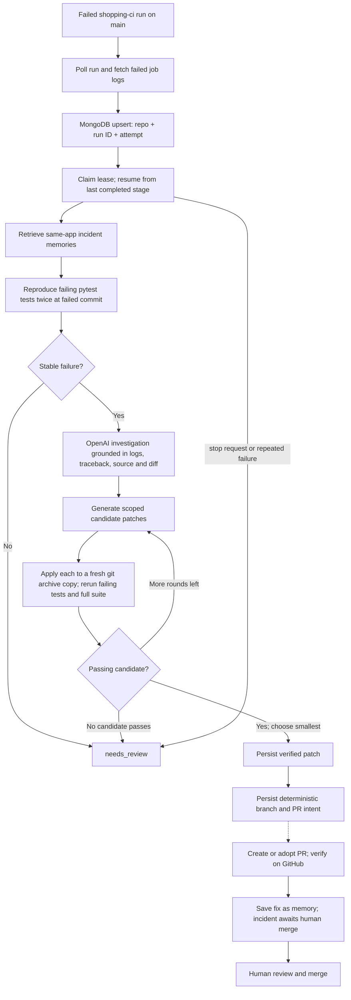
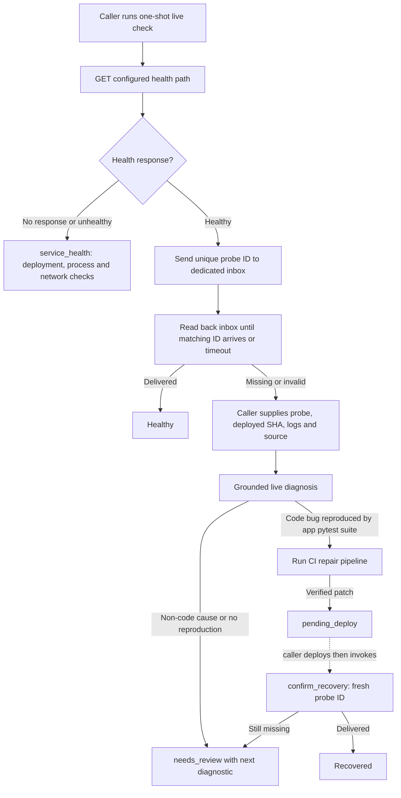

# OpsRelay and NovaMart: current system architecture

This diagram describes the code in this repository as of 2026-11-14. Solid arrows are implemented calls or data flows. Dashed arrows are available components that are not wired into the running end-to-end worker, or deployment steps that require manual action.

## End-to-end system map

```mermaid
flowchart LR
    shopper[Shopper] --> browser[Browser]

    subgraph novamart["NovaMart demo application"]
        browser -->|pages and interactions| next["Next.js storefront :3100"]
        browser -->|cart, promo, shipping| local["Browser localStorage"]
        local --> browser
        next -->|server-rendered fetches| api["FastAPI :8100"]
        browser -->|client /api requests| rewrite["Next.js /api rewrite"]
        rewrite --> api
        api --> catalog["In-code product catalog"]
        api --> checkout["CheckoutService: pricing, promotions, inventory"]
        checkout --> store["Local JSON: orders and sold stock"]
        api -->|health and checkout probe| health["Health endpoints"]
        api -->|request IDs and JSON logs| logs["Runtime logs"]
        checkout -->|quote, simulated order| api
    end

    subgraph ci["GitHub CI and failure detection"]
        source["Code pushed to main"] -.->|workflow template must be copied to .github/workflows| actions["GitHub Actions shopping-ci"]
        actions --> tests["Backend pytest and checkout probe; frontend typecheck and build"]
        tests --> artifacts["JUnit, OpsRelay report, probe JSON artifacts"]
        actions -->|failed completed run on main| monitor["FailureMonitor polls Actions"]
        monitor --> context["GitHubClient: failed jobs, logs, commit context"]
    end

    subgraph ops["OpsRelay CI incident worker"]
        context --> adapter["MonitorAdapter: FailedRun"]
        adapter --> ingest["Ingest and deduplicate incident"]
        ingest --> mongo[("MongoDB: incidents, workflow_steps, memories")]
        mongo --> worker["Orchestrator: lease, resume, stage machine"]
        worker --> memory["Find similar fixes"]
        memory <--> mongo
        memory -.->|optional embeddings| voyage["Voyage AI"]
        memory --> repair["Repairer and repair_ci_failure"]
        repair --> verify["git archive temp copies; baseline and candidate pytest"]
        verify --> diagnosis["Grounded investigation and patch proposals"]
        diagnosis <--> openai["OpenAI structured model"]
        diagnosis --> verify
        verify -->|verified patch or needs_review| worker
        worker -->|save PR intent before send| mongo
        worker -.->|missing open_draft_pr adapter| publisher["Standalone PullRequestPublisher"]
        publisher -->|branch, commit, PR; read-back verification| github["GitHub repository and pull requests"]
        github --> reviewer["Human reviews and merges"]
        worker -->|after PR confirmation| memory
    end

    subgraph live["Separate live-check path"]
        livecli["One-shot live-check CLI or caller"] --> probe["Health + send/read-back delivery probe"]
        probe -.->|Messaging endpoint contract; service not present| messaging["Messaging service placeholder"]
        probe -.->|caller supplies failed check| route["diagnose_live_failure"]
        route -->|unreachable or unhealthy| human["Service-health investigation / needs_review"]
        route -->|reachable, delivery failed, code bug reproduced| repair
        route -.->|caller invokes after deployment| fresh["confirm_recovery: fresh probe ID"]
    end

    logs -.->|caller supplies service logs| route
    artifacts -.->|available for analysis; worker currently uses job logs| context
```

## CI incident flow and durable state

The dashed PR edge is the current integration boundary. `Orchestrator._build_real()` requires `GitHubClient.open_draft_pr`, which `GitHubClient` does not provide. The orchestrator also calls `find_pr(repo, branch)`, while `GitHubClient.find_pr()` accepts a branch and optional state. `PullRequestPublisher.create_or_find_pr()` implements the GitHub side separately, including idempotent branch/commit/PR creation and verification. Its current `create_pr()` call opens a regular PR, although the orchestrator contract says draft PR. The fake GitHub demo exercises the orchestrator's complete stage sequence.

## Live service check flow

The configured Messaging probe uses `GET /health`, `POST /probe/messages`, and `GET /probe/inbox/{inbox}` by default. The service implementation has not landed; the contract is exercised against a local fixture. This live path is a callable library and CLI, not a scheduled worker.

## Current boundaries and deployment notes

| Area | Current code |
| --- | --- |
| Shopping runtime | Implemented. Next.js serves pages, FastAPI owns prices and stock, and `DemoStore` persists simulated orders in a local JSON file. No payment is charged. |
| CI workflow | `shopping/ci/shopping-ci.yml` is a template. There is no root `.github/workflows/shopping-ci.yml` in this checkout, so GitHub will not discover it until copied. |
| CI monitor | Implemented for failed, completed runs on the configured base branch. It ignores `agent/` fix branches. The worker consumes failed job logs; uploaded diagnostic artifacts are not downloaded by that path. |
| Repair | Implemented as a callable pipeline. The verifier exports the failed commit into temporary directories and runs pytest there. Unreproducible or unverified results go to `needs_review`. |
| Durable workflow | MongoDB stores incidents, leases, stage/audit records and fix memories. Atlas Vector Search is attempted for similarity, with local cosine fallback; embeddings use Voyage when configured, otherwise a local hash. |
| PR publication | The standalone publisher is implemented; the real orchestrator-to-publisher adapter is missing. It currently opens a regular PR, while the orchestrator expects a draft. Human merge is required. |
| Live checks | One-shot CLI and diagnosis/recovery functions are implemented, but no scheduled live polling worker is wired. Messaging endpoints are a contract tested by a local fixture; `message-platform/` contains only a placeholder. |
| Admin dashboard | `admin-dashboard/` contains only a placeholder; there is no UI for the incident state yet. |

## Code map

- Storefront: `shopping/frontend/src/app`, `shopping/frontend/src/lib/api.ts`, `shopping/frontend/src/lib/cart.tsx`, `shopping/frontend/next.config.ts`
- Shopping API and state: `shopping/backend/app/main.py`, `shopping/backend/app/checkout.py`, `shopping/backend/app/store.py`, `shopping/backend/app/probe.py`
- CI template and diagnostics: `shopping/ci/shopping-ci.yml`, `shopping/backend/tests/conftest.py`
- Detection and context: `agents/monitor.py`, `agents/github_client.py`, `agents/orchestrator.py` (`MonitorAdapter`)
- Diagnosis and verification: `agents/pipeline.py`, `agents/investigator.py`, `agents/patcher.py`, `agents/verifier.py`
- Durable state and memory: `agents/mongodb.py`, `agents/memory.py`, `agents/orchestrator.py`
- PR publication: `agents/github_publisher.py`, `agents/github_client.py`
- Live path: `agents/live_check.py`, `agents/live_incident.py`, `agents/services.toml`
