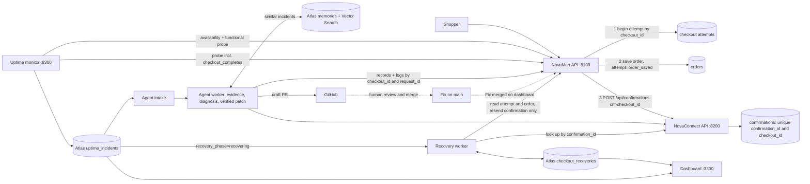
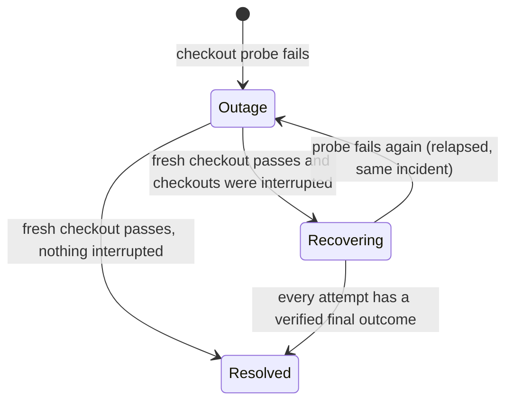

# OpsRelay, NovaMart and NovaConnect: system architecture

This document describes the code in this repository as of 2026-11-15. It is organised around one
end-to-end incident: **NovaMart saves an order, then times out calling NovaConnect for the order
confirmation, and checkout reports failure although the order exists.** Both homepages keep
loading. Solid arrows are implemented calls; dashed arrows are manual (human) steps.

## Components

| Component | Port | Code | State |
| --- | --- | --- | --- |
| NovaMart storefront | 3100 | `shopping/frontend` | browser localStorage (cart) |
| NovaMart API | 8100 | `shopping/backend/app` | JSON file: orders, sold stock, **checkout attempts** |
| NovaConnect web | 3200 | `message-platform/frontend` | |
| NovaConnect API | 8200 | `message-platform/backend/app` | SQLite: messages, **confirmations** |
| OpsRelay uptime API + monitor | 8300 | `admin-dashboard/backend/uptime` | Atlas `uptime_*`, or SQLite locally |
| OpsRelay dashboard | 3300 | `admin-dashboard/web` | reads the uptime API |
| Agent worker | | `agents/orchestrator.py` | Atlas `incidents`, `workflow_steps`, `memories` |
| Recovery worker | | `agents/recovery.py` | Atlas `checkout_recoveries` |

`./dev.sh` starts all of them. The agent and recovery workers need `MONGODB_URI` (Atlas); the
recovery worker runs in a restart loop, so a crash resumes under a new worker ID.

## End-to-end map

## 1. Checkout with a stable checkout ID

The storefront (and `uptime/demo_traffic.py`) sends one `checkout_id` per cart and reuses it on
retry. The ID comes from the request body, then the `Idempotency-Key` header, then a generated
`chk_<hex>`. It is carried through the attempt record, the order (`order.checkout_id`), the
confirmation (`confirmation_id = cnf-<checkout_id>`) and every structured log line
(`checkout_started`, `order_saved`, `confirmation_unavailable`, `confirmation_sent`,
`checkout_failed`, `checkout_succeeded`). NovaMart forwards `X-Request-ID` to NovaConnect, so
the logs of both services correlate by request ID.

`shopping/backend/app/store.py` records an attempt **before** anything else, so attempts that fail
before an order exists are still findable. Attempt states: `started`, `order_saved`,
`order_failed`, `rejected`, `completed`, `failed`. A retry with a different cart under the same
checkout ID is rejected (`409 CHECKOUT_ID_CONFLICT`). An order and its attempt state are written
in one transaction; the store refuses a second order for a checkout ID.

NovaConnect (`message-platform/backend/app/confirmations.py`) enforces unique `confirmation_id`
and unique `checkout_id` in application code. A replay returns the stored record
(`Idempotent-Replay: true`); different details under the same ID are a conflict. A confirmation is
`accepted` until it is `delivered`; an acknowledgement alone is not delivery.

Endpoints used for recovery: NovaMart `GET /api/checkouts?since&until&unfinished`,
`GET /api/checkouts/{id}`, `POST /api/checkouts/{id}/confirmation` (resends only the
confirmation), `PUT /api/checkouts/{id}/reconciliation`; NovaConnect
`GET /api/confirmations/{id}` and `GET /api/confirmations?order_id=`.

## 2. Detection

NovaMart's functional probe (`shopping/backend/app/probe.py`) runs check 9,
`checkout_completes`: a synthetic checkout against a throwaway store using the real NovaConnect
client. On failure it reports the checkout ID, request ID, error code, HTTP status, whether the
order was saved, the order ID, the confirmation status and elapsed time. The probe also reports
`interrupted_checkouts` (unfinished customer attempts in the last 24 h).

The uptime monitor turns a failing probe into an incident in `uptime_incidents`. Homepages still
pass, so the route is `investigate`, not `service_health`. CI status is extra evidence when
GitHub is configured.

## 3. Agent investigation

`agents/live_repair.py` calls `agents/checkout_evidence.py` for NovaMart incidents whose failing
check is `checkout_completes`. It gathers:

- the failed probe's checkout and request IDs, and its order and confirmation status;
- NovaMart's unfinished attempts around the incident, each looked up in NovaConnect by its
  confirmation ID;
- log lines from both services (`OPSRELAY_SHOPPING_LOG_FILE`, `OPSRELAY_MESSAGING_LOG_FILE`,
  default `.dev/logs/*-api.log`) that mention those IDs;
- recent commits that touched the file named by the probe's source hint;
- CI status, and similar past incidents from Atlas Vector Search (passed in by the orchestrator).

It states the **failure point** (e.g. "after NovaMart saved order X: the confirmation request to
NovaConnect ended with timeout after 3000 ms, and checkout returned 504"). A timeout alone leaves
the **cause** `unknown`. The result carries one `recommendation`:

| Action | When |
| --- | --- |
| `propose_code_fix` | The diagnosis is a code bug, the agent reproduced it (existing suite or a new regression test fails at the deployed commit) and the patch passes the tests. |
| `operational_step` | A dependency timed out and no recent commit touched the hinted code, so no model call or code change is made; or a service-health / provider outage. |
| `ask_for_review` | Anything else: the evidence does not support one action. |

The prompt and the incident record contain only what the services recorded. The demo's injected
fault, the expected diagnosis and the expected patch are not in either; a test asserts the
evidence text never names them.

A verified patch follows the existing workflow: save the PR intent in Atlas, open a **draft PR**,
and wait. A human reviews and merges. The agent never merges.

## 4. Fix, then reconcile interrupted checkouts

When a fresh checkout passes, the monitor marks the service **Operational** but keeps the incident
open with `recovery_phase = "recovering"` ("Recovering interrupted checkouts"). Service health and
incident recovery are separate statuses on the dashboard.

The recovery worker (`agents/recovery.py`) polls recovering incidents, takes a lease on the
incident's `checkout_recoveries` document (fenced writes, like the orchestrator) and collects the
affected attempts from NovaMart (incident start minus 5 minutes, up to the moment the service
recovered). For each one it reads the authoritative records:

| Records found | Outcome |
| --- | --- |
| Order exists, NovaConnect confirmation `delivered` | `completed` |
| Order exists, NovaConnect confirms no confirmation | save retry intent, resend **only** the confirmation (same `cnf-<checkout_id>`), read it back from NovaConnect; `completed` once read back as delivered |
| Resend acknowledged, delivery still pending | `awaiting_delivery` (not final) |
| Order confirmed absent | `failed`, and NovaMart shows the customer can retry with the same checkout ID |
| A lookup timed out, or the records conflict | `needs_review`, with the missing evidence listed; retried on the next pass |

Each final outcome is written back to NovaMart (`reconciliation` on the attempt). When every
attempt is final, the recovery phase is `complete`, the worker links the fresh checkout to the
agent's incident as `deployed_fix_verified`, and the monitor resolves the uptime incident. Attempts
that need review keep the incident open and visible.

### Crash safety

Atlas holds the incident ID, affected checkout IDs, each attempt's evidence, the retry intent
(saved **before** the resend) and the verified result. A one-shot demo fault
(`python -m agents.recovery arm-crash`, file `.dev/recovery-fault.json`) makes the worker exit
after NovaConnect records the confirmation and before OpsRelay saves the result. On restart a new
worker takes the expired lease on the same incident, sees the saved intent, looks the confirmation
up by its stable ID instead of resending, and finishes the attempt. The dashboard then shows the
same incident ID, both worker IDs and exactly one confirmation for the order.

## Accounts and workspaces

The dashboard needs a sign-in (email and password; the session is an HttpOnly cookie). Every data route
reads one workspace, and the API returns 404 for a workspace, service or incident the account does not
own. Each workspace adds the sites it monitors under **Sites** (a page URL and an optional health URL); a
GitHub Actions schedule calls `POST /api/v1/cron/check` every 5 minutes to check every workspace's sites.
The first account to sign up claims the `demo` workspace; later accounts create their own.

Under **Connectors**, a workspace connects GitHub with a token (stored server-side, never returned) and
creates its Better Stack webhook. Under **Repositories** it maps a repository the token can access to a service: base branch, deployed URL and an optional workflow check.
The API checks the branch and workflow exist on GitHub before saving the mapping.

**Better Stack alerts.** Each workspace gets its own webhook URL plus a secret that Better Stack sends as
the `X-OpsRelay-Secret` header (Better Stack doesn't sign webhooks). The payload's monitor id picks the
mapped service. One Better Stack incident is one OpsRelay incident: an exact redelivery is ignored, and
acknowledged, resolved and reopened events update that same incident.

**Notifications.** Under **Connectors**, a workspace can add outgoing connectors: Slack and Discord
incoming webhooks, a generic webhook (JSON signed with `X-OpsRelay-Signature: sha256=<HMAC of the body>`,
its secret shown once, every request through the private-URL guard) and PagerDuty (Events API v2:
trigger on open, resolve on close, deduplicated by incident). The scheduled check derives events from stored state: an incident opened or
resolved, the repair agent opening a draft PR, or handing an incident to a human. Each
(connector, incident, event) is claimed once in storage before it is sent, and a failed send releases
the claim, so a repeated run never double-posts and a failure is retried. Events from before a connector
was saved are skipped. Webhook URLs are secrets: only their last characters are returned.

**Repair agent per repository.** Each mapped repository has an agent switch (off by default) and a mode:
report only (default; the agent investigates and records a recommendation, no PR) or draft PRs. The shared
Python worker's live intake picks up a Better Stack incident only when its repository's agent is on, and
only for the repository that worker is configured for (`GITHUB_OWNER`/`GITHUB_REPO`), using the code area
chosen from `agents/apps.toml`. It then runs the same Atlas-backed stages as a monitor incident.

## Durable state in Atlas

| Collection | Owner | Holds |
| --- | --- | --- |
| `uptime_incidents`, `uptime_*` | uptime monitor | incidents, checks, service state, recovery phase |
| `opsrelay_users`, `opsrelay_emails`, `opsrelay_sessions`, `opsrelay_workspaces` | uptime API | dashboard accounts, hashed session tokens, workspaces; `opsrelay_github`, `opsrelay_repos`: GitHub connections and repository mappings; `opsrelay_bs_*`, `opsrelay_alert_*`: Better Stack webhooks, monitor mappings, delivery dedupe |
| `incidents`, `workflow_steps` | agent orchestrator | repair stage machine, PR intent, recommendation, audit trail |
| `memories` | agent orchestrator | past fixes for Vector Search |
| `checkout_recoveries` | recovery worker | per-incident attempts, evidence, retry intent, verified results, workers, events |

## Code map

- Checkout and attempts: `shopping/backend/app/checkout.py`, `store.py`, `confirmations.py`, `probe.py`, `main.py`
- Confirmations: `message-platform/backend/app/confirmations.py`, `db.py`, `main.py`, `demo_outage.py`
- Monitor and incident phases: `admin-dashboard/backend/uptime/incidents.py`, `probes.py`, `storage/mongo.py`
- Demo controls: `admin-dashboard/backend/uptime/bad_deploys.py`, `demo_outages.py`, `demo_traffic.py`
- Agent evidence and recommendation: `agents/checkout_evidence.py`, `agents/live_repair.py`, `agents/orchestrator.py`
- Recovery: `agents/recovery.py`, `agents/mongodb.py`
- Dashboard: `admin-dashboard/web/src/components/recovery.tsx`, `src/app/incidents/[id]/page.tsx`
- Tests: `agents/tests/test_checkout_recovery.py` (the five scenarios), `agents/tests/test_checkout_investigation.py`,
  `shopping/backend/tests/test_checkout_confirmation.py`, `message-platform/backend/tests/test_confirmations.py`,
  `admin-dashboard/backend/tests/test_incident_recovery_phase.py`
